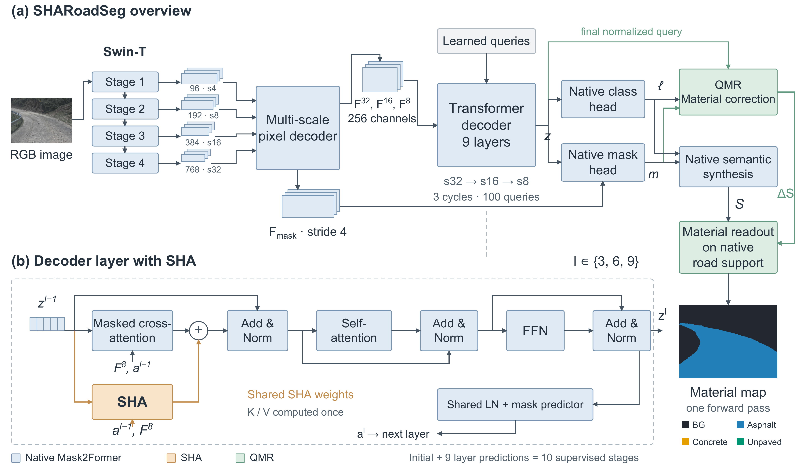
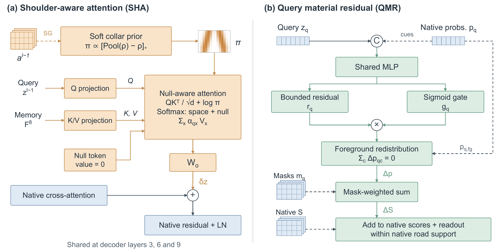
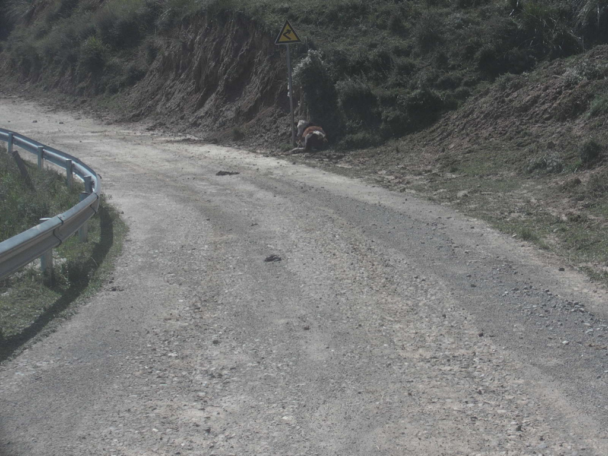
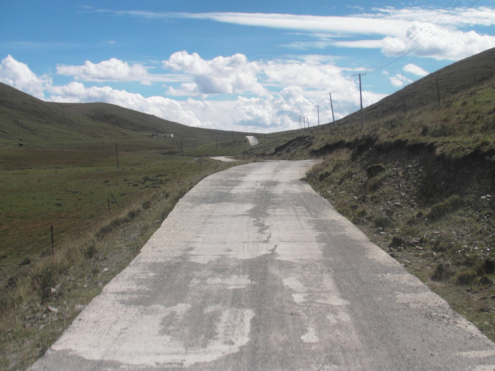
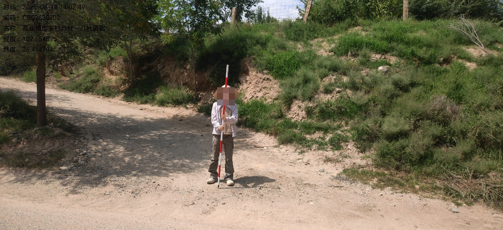
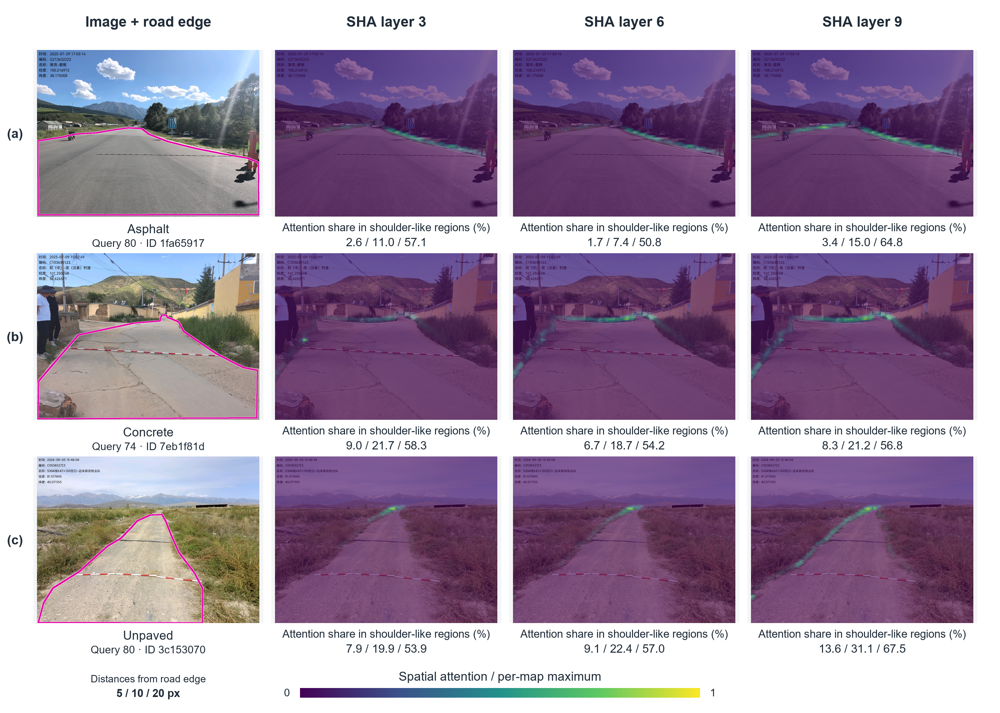

# SHARoadSeg

English | [简体中文](README.zh-CN.md)

SHARoadSeg builds on Mask2Former-Swin-T to segment rural roads into asphalt, concrete, and unpaved surfaces.

**SHA (Shoulder-Aware Attention)** aggregates context from a soft neighborhood around predicted masks. Shared attention and a learnable null option help handle ambiguous road boundaries.

**QMR (Query-Level Material Residual)** refines material predictions using query features and native confidence information while preserving the road support produced by the same forward pass.

**Overall architecture (paper Figure 1)**



**SHA and QMR modules (paper Figure 2)**



This repository provides training, evaluation, and attention visualization code. The full dataset is private; `assets/` contains only the six images from paper Figure 3 and three from Figure 4, with PNG mask annotations. Baseline configurations are in `benchmark/`.

## Installation

Use Python 3.10 and install dependencies from this directory:

```bash
python -m pip install torch==2.6.0 torchvision==0.21.0 --index-url https://download.pytorch.org/whl/cu124
python -m pip install -r requirements.txt
```

## Usage

Run the examples, evaluation, or single-image SHA attention visualization (paper Figure 4). These commands use the bundled best checkpoint by default:

```bash
python demo.py --out outputs/demo
python evaluate.py --device cpu --out outputs/evaluation
python visualize_attention.py --input-image assets/images/fig4_asphalt_01.png --out outputs/attention
```

Single-image visualization does not require annotations. Optionally add `--input-mask assets/masks/fig4_asphalt_01.png` to supply a mask. Mask values are 0 background, 1 asphalt, 2 concrete, and 3 unpaved. Each output directory must be new.

`weights/best.pt` is the paper's best SHARoadSeg checkpoint. `weights/pretrained/` contains the Cityscapes-pretrained Mask2Former used for training initialization by default; `weights/swin_t/` contains the standalone ImageNet-pretrained Swin-T.

For training, provide an external data configuration following [data.example.json](configs/data.example.json):

```bash
python train.py --data /path/to/data.json --out outputs/train
```

Training requires a CUDA GPU with BF16 support.

## Road segmentation examples (paper Figure 3)

`demo.py` generates these results using the best checkpoint. [All six individual predictions](assets/results/segmentation) use the paper's colors: blue for asphalt, orange for concrete, and green for unpaved surfaces.

| Input image | SHARoadSeg prediction |
| --- | --- |
|  |  |
|  |  |
|  |  |

## SHA attention visualization example (paper Figure 4)


