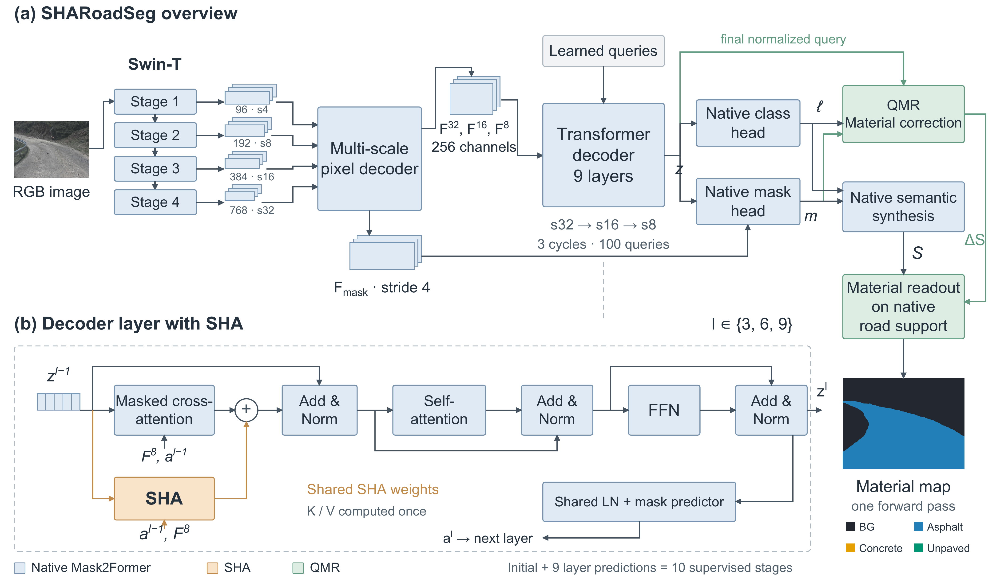
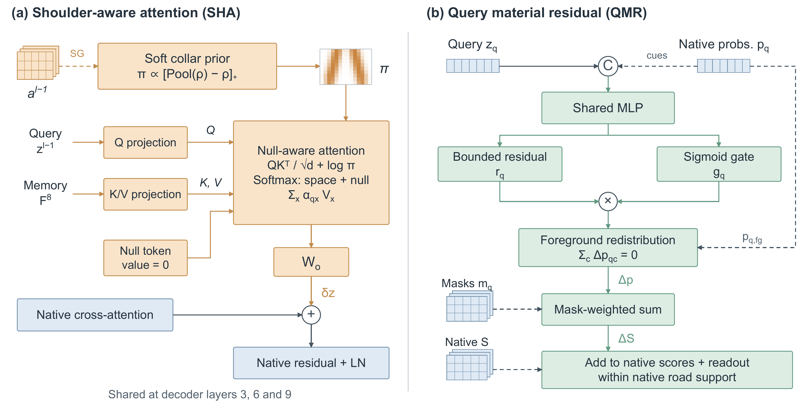
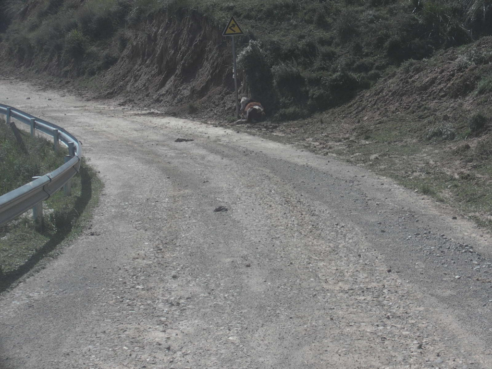
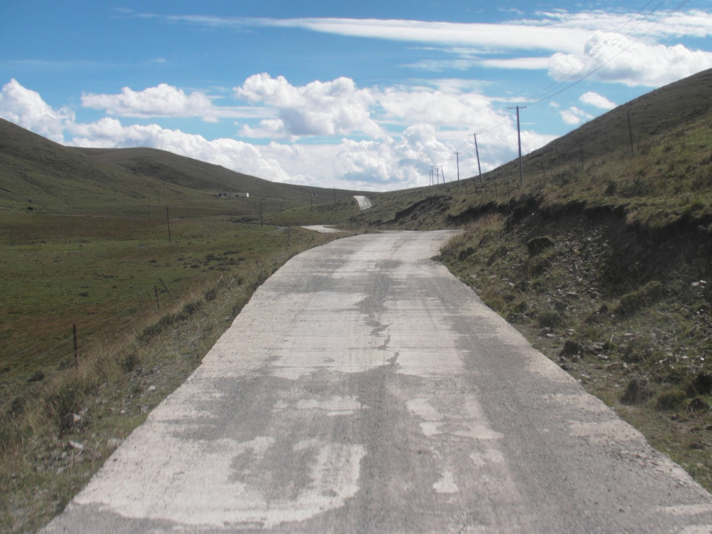
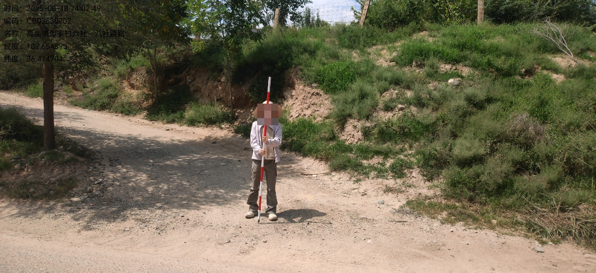
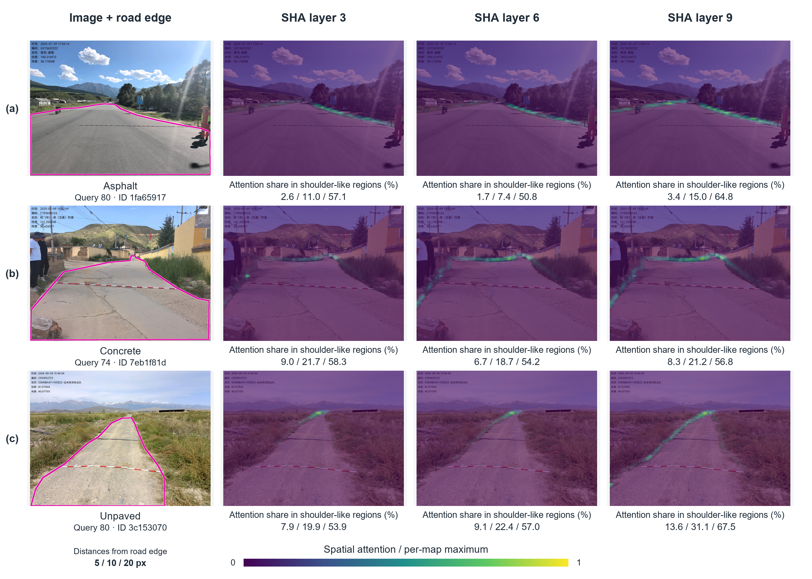

# SHARoadSeg

[English](README.md) | 简体中文

SHARoadSeg 基于 Mask2Former-Swin-T，面向农村道路分割，识别沥青、水泥混凝土和未铺装路面。

**SHA（路肩感知注意力）**：聚合预测掩码周围的软邻域上下文，通过共享注意力与可学习的空选项，辅助处理模糊的道路边缘。

**QMR（查询级材质残差）**：利用查询特征和原生置信信息细化材质预测，同时保留当前前向传播产生的道路范围。

**整体框架（对应论文图1）**



**SHA 与 QMR 模块（对应论文图2）**



本项目提供训练、评价和注意力可视化代码。完整数据集不公开，仅在 `assets/` 提供论文图3的 6 张、图4的 3 张图片及 PNG mask 标注；基线模型配置位于 `benchmark/`。

## 安装

使用 Python 3.10，在本目录安装依赖：

```bash
python -m pip install torch==2.6.0 torchvision==0.21.0 --index-url https://download.pytorch.org/whl/cu124
python -m pip install -r requirements.txt
```

## 使用

运行样例、评价或单图 SHA 注意力可视化（对应论文图4），默认使用随包最佳权重：

```bash
python demo.py --out outputs/demo
python evaluate.py --device cpu --out outputs/evaluation
python visualize_attention.py --input-image assets/images/fig4_asphalt_01.png --out outputs/attention
```

单图作图无需标注；可用 `--input-mask assets/masks/fig4_asphalt_01.png` 指定 mask。标注像素值为 0 背景、1 沥青、2 水泥混凝土、3 未铺装。各输出目录需尚不存在。

`weights/best.pt` 是本文最佳模型，`weights/pretrained/` 是训练默认使用的 Cityscapes 预训练 Mask2Former，`weights/swin_t/` 是独立的 ImageNet 预训练 Swin-T。

训练时提供外部数据配置，格式参考 [data.example.json](configs/data.example.json)：

```bash
python train.py --data /path/to/data.json --out outputs/train
```

训练需要支持 BF16 的 CUDA GPU。

## 道路分割样例（对应论文图3）

`demo.py` 使用最佳权重生成以下结果；[全部 6 张单图结果](assets/results/segmentation)采用论文配色：蓝色为沥青，橙色为水泥混凝土，绿色为未铺装。

| 输入图像 | SHARoadSeg 预测 |
| --- | --- |
|  |  |
|  |  |
|  |  |

## SHA 注意力可视化样例（对应论文图4）


